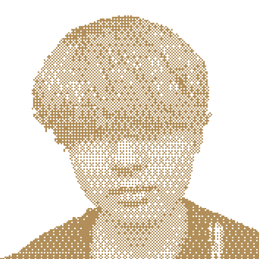

#  RedZone (Vinxen)

A workplace-safety demo that streams webcam frames from a React app to an Elysia backend, asks Google Gemini to classify visible industrial hazards, and logs the result — built on top of "Vinxen", a Bun monorepo starter with a `vinxen create` CLI for assembling fullstack apps from template packages.

**Status:** Prototype — a weekend/hackathon build. The hazard-detection flow (webcam → `/api/ai/gemini/analyze-image` → SQLite log) works; the auth plugin is written but not mounted, the CLI generator is a first pass, and `packages/fe` duplicates code that also lives in `apps/fe`. No CI; one unit test file (`packages/be/auth/time-utils.test.ts`).

## Features

- **Hazard analysis endpoint** — `POST /api/ai/gemini/analyze-image` takes a base64 image, calls `gemini-2.0-flash-lite` with a structured-output schema and stores `{ level, message, solution }` as a `Log` row. Levels map to hazard categories (entanglement, pinching, falls, collision, electric shock, collapse, …) with `-1` meaning no issue.
- **Webcam client** (`apps/fe`) — `react-webcam` capture loop, a log feed with search, and a theme context; talks to the API with axios through the Vite dev proxy.
- **Generic CRUD plugin** (`@vinxen/database`) — Elysia plugin that exposes list / create / get / update / delete / patch routes and bulk operations for Prisma models under a prefix (`/api` here).
- **Auth plugin** (`@vinxen/auth`) — JWT access/refresh cookies, `/login`, `/register`, `/me`, `/refresh`, `/logout`, permission helpers (present, currently commented out in the server).
- **Shared schemas** (`@vinxen/shared`) — TypeBox API response envelopes and auth schemas; Prisma generates `prismabox` and `zod` schemas into `packages/shared/generated`.
- **CLI** (`@vinxen/cli`) — `vinxen create [name]` prompts for an app template and packages from this repo and copies them (respecting `.gitignore`) into a new project.

## How it works

`apps/be/src/index.ts` builds an `Elysia` app with CORS (localhost 5173/3000), Swagger, a decorated `PrismaClient`, the `database` plugin and the Gemini route, then listens on `PORT`. `packages/be/gemini/index.ts` wraps `@google/genai` with a fixed prompt and JSON response schema (`Accident.Tag`, `Message`, `Solution`). The frontend `useImageAnalysis` hook posts screenshots on a timer and renders the returned log entries. Prisma models: `User`, `Permission`, `Post`, `Log` (SQLite).

## Tech stack

- Runtime/Language: Bun, TypeScript 5 (CLI package targets Node via `tsc` / `tsx`)
- Backend: Elysia 1.3, `@elysiajs/cors`, `@elysiajs/swagger`, `@elysiajs/jwt`, `@google/genai`
- Frontend: React 19, Vite, react-router-dom 7, styled-components, react-webcam, axios
- Storage: Prisma 6 + SQLite, prismabox, prisma-zod-generator
- CLI: commander, `@inquirer/prompts`, fs-extra, chalk

## Getting started

### Requirements

- [Bun](https://bun.sh/)
- A Google Gemini API key

### Install

```bash
git clone https://github.com/eunhhu/RedZone
cd RedZone
bun install
```

### Run

```bash
# backend
cd apps/be
# create .env with DATABASE_URL and GEMINI_API_KEY (see Configuration)
bunx prisma generate
bunx prisma db push
bun run dev          # bun --hot src/index.ts → http://localhost:3000 (Swagger at /swagger)

# frontend
cd apps/fe
bun run dev          # vite → http://localhost:5173
bun run build        # tsc -b && vite build
```

Root scripts (`bun run build|test|dev`) fan out to every workspace with `--recursive`.

### CLI

```bash
cd packages/cli
bun install
bun run build        # tsc → dist/
node dist/src/index.js create my-app     # or: bun run dev (tsx watch)
```

The `vinxen` binary is in `packages/cli/bin/`; it is not published to npm.

## Project structure

```text
apps/
  be/              Elysia server + prisma/schema.prisma
  fe/              React + Vite webcam client
packages/
  shared/          TypeBox API response + auth schemas, generated Prisma schemas
  be/auth/         JWT auth Elysia plugin (+ time-utils test)
  be/database/     generic Prisma CRUD Elysia plugin
  be/gemini/       analyzeImage() wrapper around @google/genai
  fe/ui/           theme, router, layout components (template material)
  fe/services/     HTTP / WebSocket / PeerJS / storage service classes
  cli/             @vinxen/cli — `vinxen create`
assets/            icon.svg
CLAUDE.md          Bun conventions used when generating code
```

## Configuration

Backend environment variables (read via `process.env`; Bun loads `.env` automatically):

| Variable                   | Purpose                                            |
| -------------------------- | -------------------------------------------------- |
| `PORT`                     | listen port (default `3000`)                       |
| `DATABASE_URL`             | Prisma SQLite URL, e.g. `file:./dev.db`            |
| `GEMINI_API_KEY`           | Google Gemini API key for image analysis           |
| `JWT_SECRET`               | access-token secret (auth plugin; insecure fallback if unset) |
| `JWT_REFRESH_SECRET`       | refresh-token secret (auth plugin)                 |
| `ACCESS_TOKEN_EXPIRES_IN`  | default `15m`                                      |
| `REFRESH_TOKEN_EXPIRES_IN` | default `7d`                                       |
| `NODE_ENV`                 | `production` marks auth cookies as `secure`        |

Package-level docs (Korean): [`packages/be/auth/README.md`](packages/be/auth/README.md), [`packages/be/database/README.md`](packages/be/database/README.md).

## License

No license file yet.
